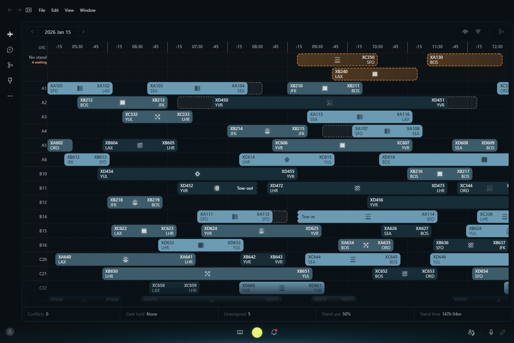
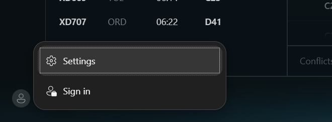
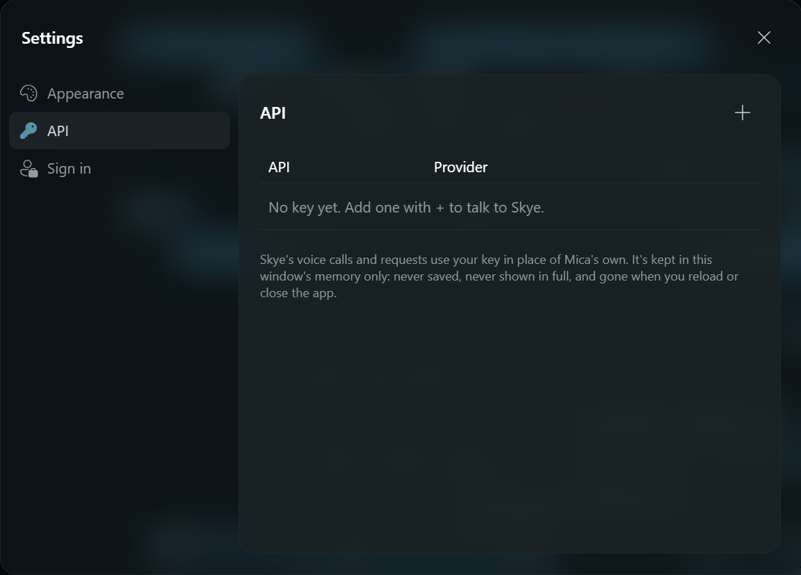
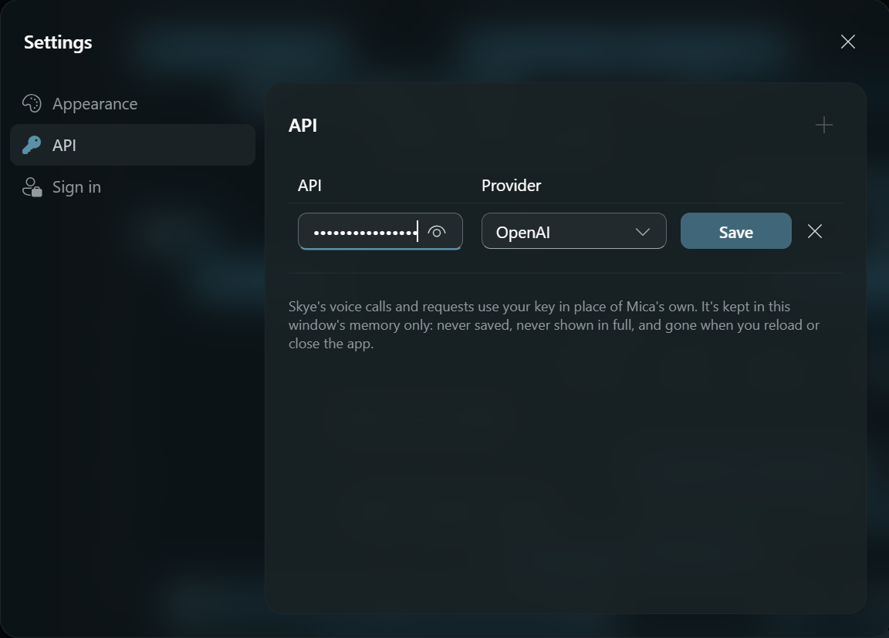
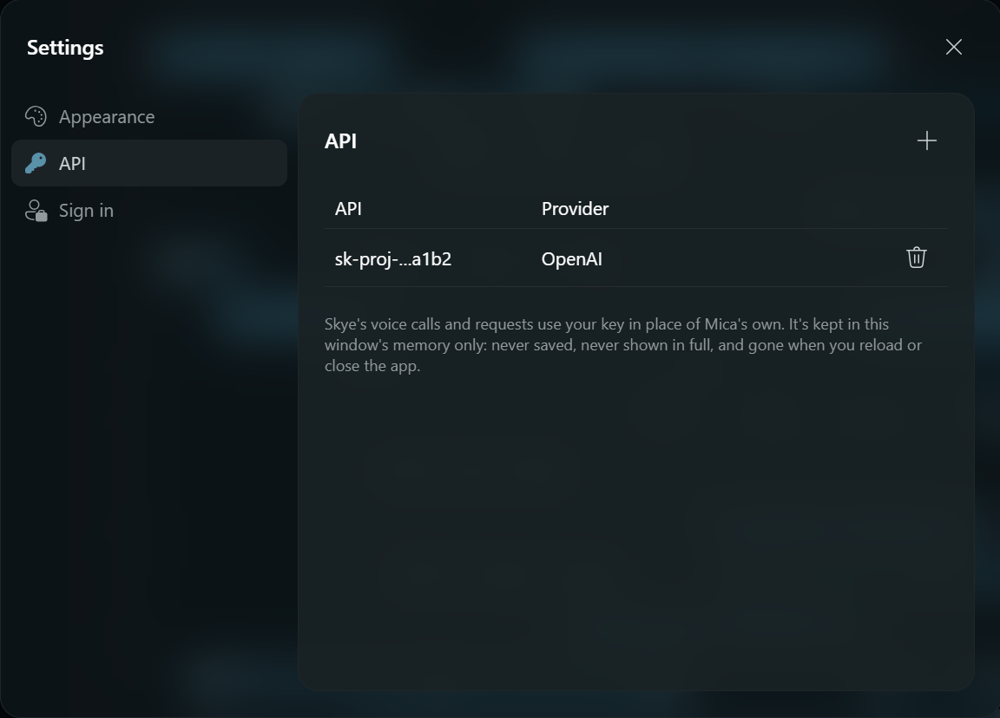

# GTAA Mica

Stand planning for Norvara Intl Airport, with Skye, a chat and voice
assistant that reads the board and moves flights for you. It runs in a browser
or as a Windows desktop app.



Skye runs on OpenAI: GPT-Live (`gpt-live-1`) for voice, and `gpt-6-luna` to
turn what you ask into actions on the board. You need an OpenAI API key with
access to both. Without a key the stand plan still works, but Skye can't talk
or act.

There are two ways to run it:

- **[Download the Windows app](#download-the-windows-app)** and paste your key
  into its Settings. Nothing else to install or configure.
- **[Run it from source](#run-it-from-source)** with your key in a `.env` file.

## Download the Windows app

1. Open the [latest release](https://github.com/mochimilk/gtaa-mica/releases/latest)
   and download `GTAA-Mica-win32-x64.zip`. The repository is private, so you
   need read access to it to see its releases.
2. Unzip it anywhere and run `GTAA Mica.exe`. The app isn't signed, so Windows
   SmartScreen may warn you the first time: choose **More info → Run anyway**.
3. Click the account button at the bottom of the left rail, then **Settings**.

   

4. Choose **API**, then **+**.

   

5. Paste your OpenAI API key (it starts with `sk-`), leave the provider as
   **OpenAI**, and select **Save**.

   

6. The key shows masked. Close Settings.

   

7. Click Skye's orb at the bottom centre of the window to start a voice call,
   or the keyboard button beside it to type to her instead. For voice, Windows
   needs microphone access turned on for desktop apps (**Settings → Privacy &
   security → Microphone**).

The key stays in the app's memory only. It's never written to disk and is gone
when you close or reload the app, so add it again each time you open it. To
remove it sooner, use the trash button next to it.

## Run it from source

You need [Node.js](https://nodejs.org/) 22.12 or newer and an OpenAI API key.

1. Get the code and install its dependencies:

   ```sh
   git clone https://github.com/mochimilk/gtaa-mica.git
   cd gtaa-mica
   npm install
   ```

2. Copy the settings template to `.env`:

   ```sh
   cp .env.example .env            # macOS, Linux or Git Bash
   Copy-Item .env.example .env     # PowerShell
   ```

3. Open `.env` and set your key:

   ```sh
   OPENAI_API_KEY=sk-...
   ```

   The template already sets `MICA_INTERPRETER_MODEL=gpt-6-luna`, which Skye
   needs to act on what you ask; leave the rest as it is. `.env` is
   gitignored, so the key stays on your machine.

4. Start Skye's voice server and the app, in two terminals:

   ```sh
   npm run dev:voice    # Skye's local voice server; reads .env
   npm run dev          # the app
   ```

   `dev:voice` prints which settings it found, including whether the key is
   set (never the key itself).

5. Open <http://localhost:5173> and click Skye's orb at the bottom centre to
   connect.

To run it in a desktop window rather than the browser, use
`npm run dev:desktop` in place of `npm run dev`, with `dev:voice` still
running.

The key lives only in the voice server (`server/micaLiveServer.mjs`), which
runs on your machine and makes the OpenAI calls for the app; the page never
sees it. Never put it in a `VITE_*` variable, as those are built into the
page. Without `dev:voice` running, the app still works and shows Skye's voice
as disconnected. Every setting in `.env`, and how a call works, is in
[docs/gpt-live-voice.md](docs/gpt-live-voice.md).

## Build the Windows app

```sh
npm run package:desktop
```

This writes `desktop-out/GTAA Mica-win32-x64/`, with `GTAA Mica.exe` inside.
Zip that folder as `GTAA-Mica-win32-x64.zip` to share it or attach it to a
release. It's an unsigned prototype for the OS and CPU you build it on, with
no installer or updates. A build made this way takes its key from
Settings → API, as above.

## Check and test

```sh
npm test               # key-free tests; never calls an API
npm run build          # checks TypeScript and builds the web app into dist/
npm run preview        # serves dist/
```

## Desktop development (Electron)

The desktop window and browser use the same React UI in `src/`.

```sh
npm run dev             # Browser workflow
npm run dev:desktop     # Vite + a native Electron window, with renderer hot reload
```

The desktop command starts its own Vite server on an available loopback port
and prints the exact URL. It leaves existing web servers running; that printed
URL can also be opened in a browser. React/CSS edits update both renderers.
Restart `dev:desktop` after changing Electron's main process or its launcher.
Quit the app with Cmd+Q (macOS) or stop the command with Ctrl+C to stop its
owned Vite server. On macOS, closing the last window leaves the app running;
click its Dock icon to reopen it.

```sh
npm run build:desktop   # Check desktop JavaScript types and build the shared UI
npm run start:desktop   # Open the built UI locally (run build:desktop first)
npm run package:desktop # Build an unsigned prototype for the current OS/CPU
```

Local bundles are written to the ignored `desktop-out/` directory. These are
smoke-test bundles, without installers, release signing, notarization or
updates. Packaging runs on the current host; Windows distribution still needs
Windows testing. The browser production output remains `dist/`.

`electron/main.mjs` owns only the window, lifecycle and restricted local asset
protocol (`mica://app`). The packaged app loads `dist/` without a web server;
root-relative public assets resolve on that origin.
The renderer has Node integration disabled, context isolation and sandboxing
enabled, denied native permission requests, and restricted navigation/popups.
On Windows and Linux the page draws the title bar (`src/components/title-bar`):
File, Edit, View and Window at its start, the native window controls over its
end, in the page's colour. Its menus are the only preload API
(`electron/preload.cjs`), checked in `electron/titleBar.mjs`; macOS keeps its
own title bar and menu bar. On Windows 11 (22H2 and later) the window's base
layer is Mica, Microsoft's material for long-lived app windows
(`electron/backdrop.mjs`): the desktop wallpaper, tinted by the system theme,
shows behind the title bar, nav rail and app bar, and the content sits on it as
a translucent layer. The preload marks `<html data-backdrop="mica">` and the
page paints only a tint over it (black at 50% in the dark theme, white at 50%
in the light) and a band at 80% up the bottom third, `colorNeutralBackground5`
into `colorNeutralBackground4` into transparent, behind Skye's glow (`LumaSkyeBackground`); Windows falls back to a solid colour
while the window is inactive or transparency effects are off. Packaged content has a CSP; inline
styles remain allowed for Fluent/Griffel. Development uses Vite's usual HMR
scripts. A future native capability should expose a narrow validated preload
API rather than adding Node access to React.

Selection and alert acknowledgement remain in-memory demo state. Electron does
not add a backend, login or persistence. UI state in separate windows/browser
tabs is independent even though the source code is shared.
